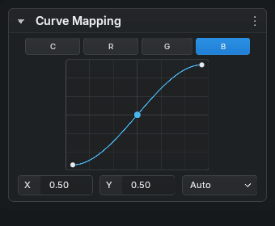
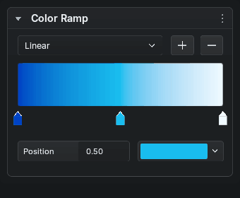
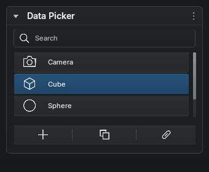
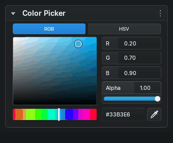
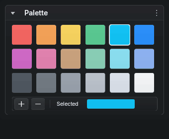
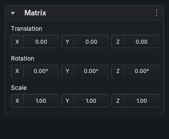
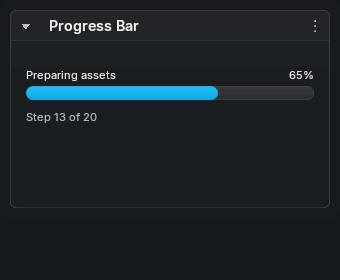
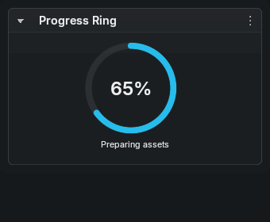
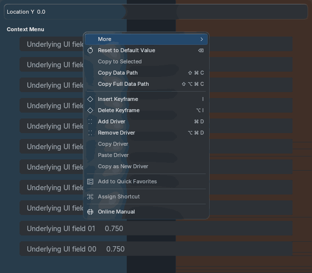

# Beyond UI for Blender

A modular, vendorable custom UI library extracted from Beyond VTuber Tools'
Effect Layers interface: retained layout, custom controls, glass/refraction,
vector icons, inline editing, searchable lists and bounded previews.

**Development status:** the extraction and initial custom backend work. Full
custom parity with Blender's UI API is **not complete**, and exact matching to
the complete generated visual specifications is **not established**. Tyler approved
the prior four controls' presented resting state; new controls and motion await QA. The release gate
tracks these honestly; a native wrapper does not count as custom parity.

[Next batch QA](docs/design/qa/next-v1/index.html) ·
[Visual specification](docs/design/references/specialized-controls-v1.png) ·
[Custom parity ledger](docs/CUSTOM_PARITY.json) ·
[Validation](docs/VALIDATION.md) · [Integration](docs/INTEGRATION.md)

## Panel overview

Actual Blender-rendered panels with the shared squash-and-stretch animations.
These previews show the current implementation; full API and visual parity are
still in progress. [Animation settings](docs/ANIMATION.md) control strength and
whether motion is enabled.

| Curve Mapping | Color Ramp |
| --- | --- |
|  |  |
| **Data Picker** | **Color Picker** |
|  |  |
| **Palette** | **Matrix decomposition** |
|  |  |
| **Progress Bar** | **Progress Ring** |
|  |  |

[Full motion overview](docs/design/qa/next-v1/motion.gif) ·
[Generated references versus implementations](docs/design/qa/next-v1/all-controls-comparison.png)

Previews explicitly use the fixed artwork palette and translucent tint fallback
over a neutral backdrop. Production defaults to Blender’s active theme across
all eight panels; see [theme configuration and QA](docs/THEMING.md). A consuming
host can provide the shared blurred viewport backdrop. [Capture provenance](docs/media/panels/provenance.json).

## Context menus

Shared right-click menus now support owner-aware property actions, nested Back
navigation, keyboard shortcuts, cancellation and delayed descriptions. Menus
and tooltips use BVT’s liquid-glass blur/refraction by default in the embedded
host, with one retained backdrop shared across controls and animation frames.



[Glass versus tint and all eight control targets](docs/design/qa/context-menu-v1/index.html) ·
[Context menu integration](docs/CONTEXT_MENUS.md) ·
[Menu capture provenance](docs/media/panels/context-menu-provenance.json)

The menu core is execution-tested on Blender 5.1.2 and 5.2.2. Native-button-only
actions remain explicit adapter gaps; exact generated-reference/motion acceptance
is still open. The earlier panel GIFs above are tint-fallback fixtures; this menu
preview exercises the real liquid-glass path.

## Requirements

Every control must have custom appearance **and** custom interactions. Generated
references are exact visual specifications, not loose inspiration. Geometry,
spacing, typography, icons, colors, glass treatment and depicted states must
match. An actual Blender capture and direct reference comparison are required
before visual acceptance. These are hard rules in [AGENTS.md](AGENTS.md).

## Vendor into an extension

Copy the `beyond_ui/` package, including `LICENSE`, `NOTICE` and optional native
artifacts, into your extension's `vendor/` folder. Import it relatively; no pip
install or global Python path modification is required.

```python
from .vendor.beyond_ui import Layout

# Custom authoring: use the returned canvas with your host adapter.
ui = Layout(context=context, commit=on_committed_edit)
ui.label(text="Settings")
ui.prop(settings, "enabled")
ui.prop(settings, "strength", slider=True)
ui.template_color_picker(settings, "color")
canvas = ui.canvas
```

Your extension owns settings, operators, registration, undo and translations.
Unsupported custom methods raise `UnsupportedControl`; there is no silent
native-widget fallback. The [ledger](docs/CUSTOM_PARITY.json) includes limitations
of partially implemented methods; `supports()` is not a visual acceptance claim.

For an owned N-panel or Properties panel, use
`beyond_ui.hosts.panel.PanelHost`. It anchors custom GPU controls inside the native
layout. The experimental bundled adapter is restricted to exact macOS arm64
Blender builds. Other platforms can use pure components or an explicitly chosen
native compatibility UI while a custom host adapter is qualified.

See [examples/demo.py](examples/demo.py) for registration, stable input activation,
per-region canvases, event routing, invalidation and teardown.

## Components

* `Canvas`, `Layout`, `Binding`, `Edit`: retained controls and host-owned edits.
* `widgets`: custom color picker, curve/ramp editor, searchable data picker,
  virtualized palette, read-only matrix decomposition and progress bar/ring.
* `AnimationSettings`: shared source springs with live enable/strength policy;
  see [animation integration and remaining gaps](docs/ANIMATION.md).
* `components`, `virtual`, `editing`: Blender-independent layout/search/clipping,
  indexed virtualization, text selection, safe number parsing and color math.
* `gpu`: extracted rounded primitives, semantic vector icons, finite springs,
  theme roles, shared glass and bounded texture/material previews.
* `hosts`: exact-build native N-panel anchor and independent owner lifecycle.

Imports do not register RNA, install timers, mutate scenes/preferences, download
code or invoke compilers. Relative imports isolate vendored copies. Optional
native callbacks are multiplexed so extensions cannot replace each other's
callback ownership.

## Optional native compatibility

`NativeLayout(self.layout)` forwards the full installed Blender UI API unchanged,
including specialized templates. It retains native behavior and is useful as a
compatibility path or test reference. It **does not satisfy custom parity**.
Native Panel/Menu/Header/UIList classes remain host-owned.

The exact-version [API inventory](docs/api_inventory.json) covers Blender
4.2–5.2 and includes all documented members, not just selected examples.
[The routing table](docs/COVERAGE.md) documents the native reference surface;
[the custom ledger](docs/CUSTOM_PARITY.json) is the custom implementation authority.

## Development

```sh
uv sync
uv run python -m unittest discover -s tests
uv run ruff check beyond_ui tests tools examples
uv run python tools/check_custom_parity.py
python3 tools/run_blender_tests.py --blender /path/to/blender
python3 tools/run_blender_tests.py --blender /path/to/blender --windowed
```

`tools/check_custom_parity.py --require-complete` is the strict release gate.
It currently fails because full custom parity and exact reference matches are
unfinished. Ordinary CI verifies the ledger's completeness and current code;
passing CI must not be described as full UI parity.

Runtime runners use disposable profiles, timeouts and mandatory result records.
They never save the user's current Blender file or preferences. The optional
macOS bridge is built explicitly with `python3 tools/build_bridge.py`.

[Architecture](docs/ARCHITECTURE.md) · [Provenance](docs/PROVENANCE.md)

GPL-3.0-or-later. Preserve the license and notice when vendoring.
