# Beyond UI for Blender

**BVT liquid glass, bouncy controls, and Blender-style panel code.**
Vendor one package into your add-on. Keep your operators and properties; author
custom panels with familiar `self.layout.prop()`, `row()`, `menu()` and `popover()`
calls. No pip install or separate UI add-on required.

[Quick integration guide](docs/INTEGRATION.md) · [Copy-ready add-on](examples/single_line.py) ·
[Current visual review](docs/design/qa/core-review-v2/index.html) ·
[Feature overview](docs/design/qa/overview/index.html)

## Make it your own

Opt into reusable presets for colors, opacity, sizes, glass cards and motion.
Unspecified colors still follow Blender. Keep ordinary panel code and owner menus.

```python
from ._vendor.beyond_ui import integrate, StyleSheet
studio = StyleSheet(colors={"accent": "#F17C67"},
                    motion={"enabled": True, "strength": 0.7, "speed": 1.0})
integrate(globals(), stylesheet=studio)
```

[Styling guide](docs/STYLING.md) · [Copy-ready presets](examples/theme_presets.py) ·
[CamKeys Studio JSON](examples/themes/camkeys-studio.json) ·
[CamKeys references vs Blender renders](docs/design/qa/camkeys-studio-v5/index.html)

The CamKeys consumer preview includes a live Appearance dialog. These recordings
show actual Blender renders; generated-reference acceptance remains open.

| Live customization | Branded panel |
| --- | --- |
| 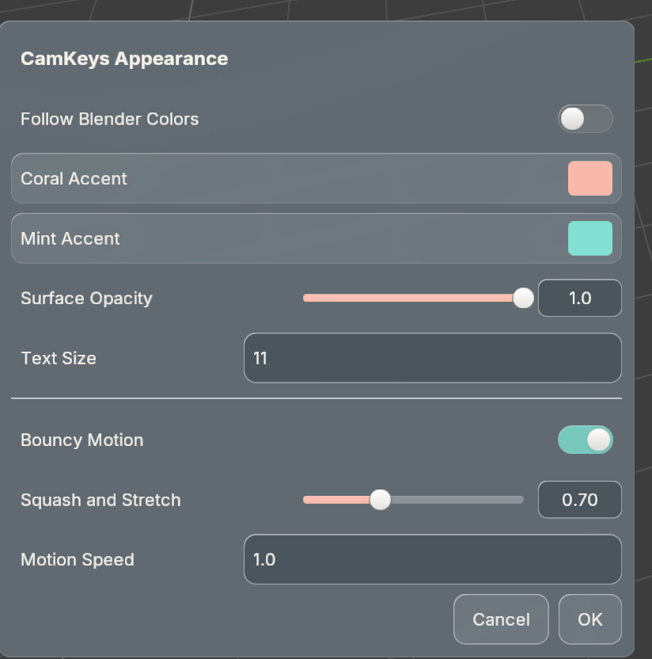 | 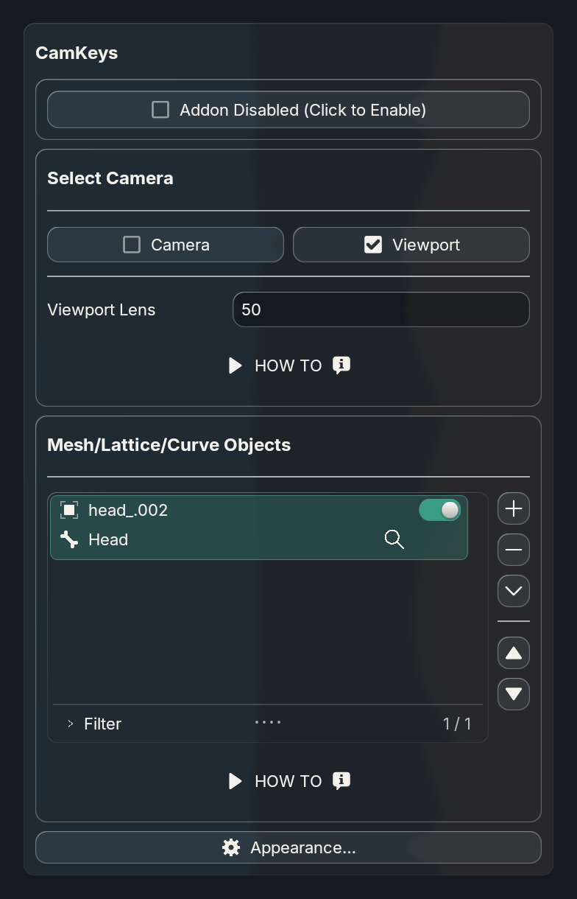 |

## One extra line of styling

Keep native Blender calls and add reusable styles after them:

```python
from ._vendor import beyond_ui as bui

row.prop(camera, "lens")
bui.style(row, units="mm", precision=1, value_width=78, padding=(3, 8))
```

The helper is a no-op on native Blender layouts. Compose dictionaries for spacing,
alignment, dimensions, colors, typography, motion and numeric presentation.
[Inline styling guide and supported options](docs/INLINE_STYLES.md).

## Drop it in

From this repository's checkout:

```sh
python tools/vendor.py /path/to/my_addon/_vendor
```

Add **one line** at the bottom of your add-on's `__init__.py`, after its existing
`register()` / `unregister()` definitions and before any script-run guard:

```python
from ._vendor.beyond_ui import integrate; integrate(globals())
```

Keep your existing `bpy.types.Panel` classes, `self.layout` calls and registration
code. Manual registration, aliased registration functions, Blender's
`register_classes_factory`, and delegating module loaders all use the same hook.
No class-base search-and-replace is needed. Exclude `_vendor` from recursive
module discovery if your loader scans dependencies.

Supported N-panel and Properties-panel bodies use the custom renderer. Conditional
rows update on normal Blender layout draws; unchanged commands retain their
canvases and motion state. The helper owns input startup, undo boundaries,
shortcuts and teardown, scoped to your package.

Owned operator callbacks route property dialogs/popups, confirmations, enum
search, callback menus/pies and `wm.call_menu*` through the custom UI. Existing
shortcuts targeting your registered menus are adapted too—even in menu-only
add-ons. Operator state, cancellation, `check()` and undo are preserved.

**This is not an automatic replacement of every native surface.** Panel headers,
auto-executing redo popups, indirect helper calls and unsupported layout modes
remain explicit limits. `__beyond_ui_integration__.status` reports detected routes,
rendering fallbacks and errors. Exact-build host requirements still apply below.

**Consumer-tested:** CamKeys' tested panels, lists and three brush-falloff popovers
now run through the custom controls on Blender 5.1.2/5.2.2. The integration assigns
persistent collection row IDs outside drawing. CamKeys keeps brush preparation
and undo in its own lifecycle hooks. [Consumer results and limits](docs/CAMKEYS_MIGRATION.md).

[Single-line example](examples/single_line.py) ·
[Integration and limits](docs/INTEGRATION.md) ·
[Explicit lifecycle alternative](examples/panels.py)

## Current controls in motion

Actual Blender GPU captures with current core styling. Synthetic light/purple
fixtures demonstrate theme roles; they are not installed presets.

| Sliders, switches and numeric entry | Menus, search and component fields |
| --- | --- |
| 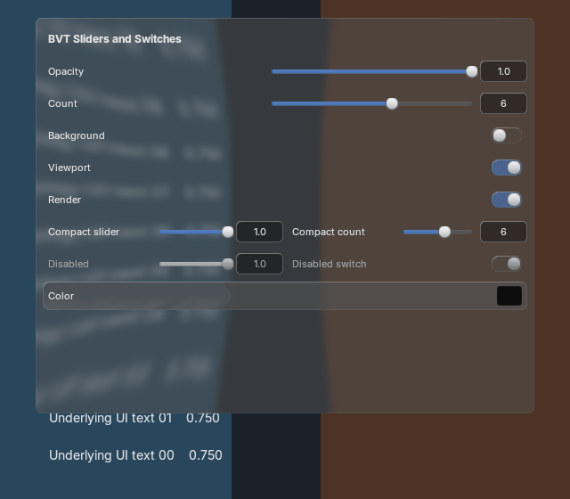 | 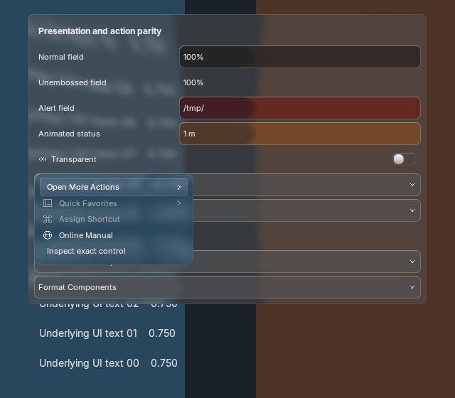 |
| **Actions and confirmation popovers** | **Theme support** |
| 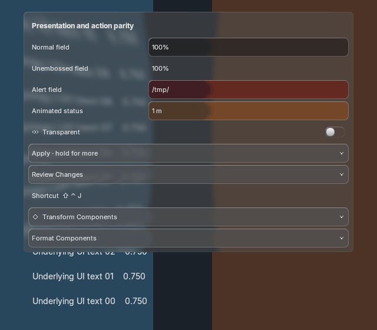 | 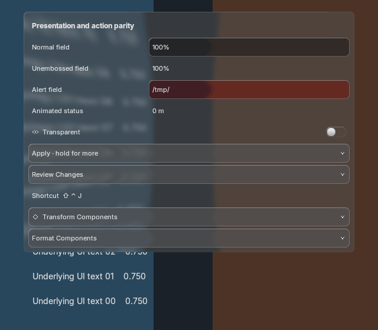 |

| Searchable menus | Color picker |
| --- | --- |
| 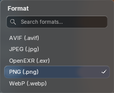 | 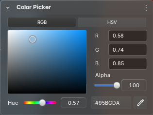 |
| **Curve fields** | **Color ramp fields** |
| 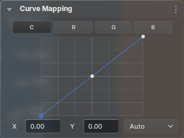 | 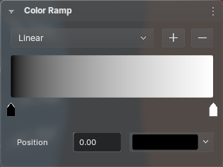 |

### CamKeys consumer review

Actual list and brush captures from the isolated consumer branch. These retain the
shared renderer, glass, motion and owner menus. Real embedded N-panel captures now cover the text batching defect that offscreen tests missed. Original source icons, compact action rails and narrow status rows are included; exact-reference acceptance remains pending.
[Review the responsive Forced Perspective panel, generated reference and width comparisons](docs/design/qa/forced-perspective-v2/index.html).

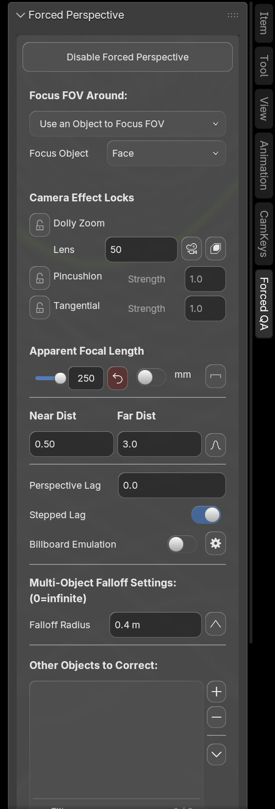

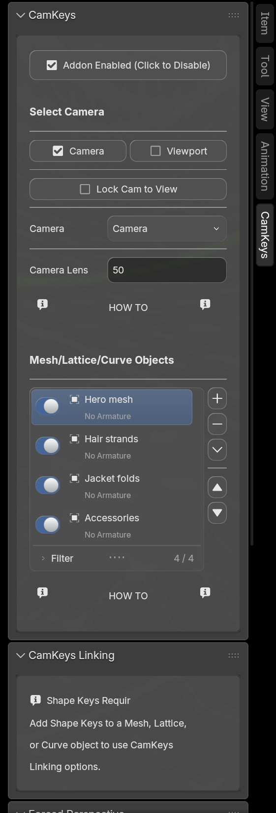

[Review generated list target, actual embedded captures and before/after comparisons](docs/design/qa/camkeys-visual-v4/index.html).

| Tracked-object list | Brush falloff |
| --- | --- |
| 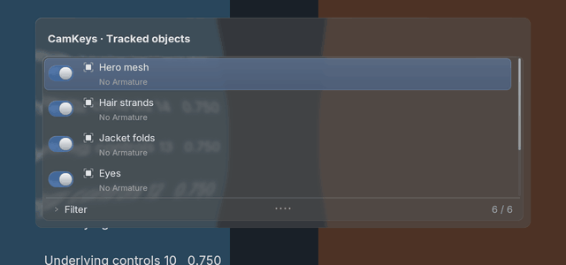 | 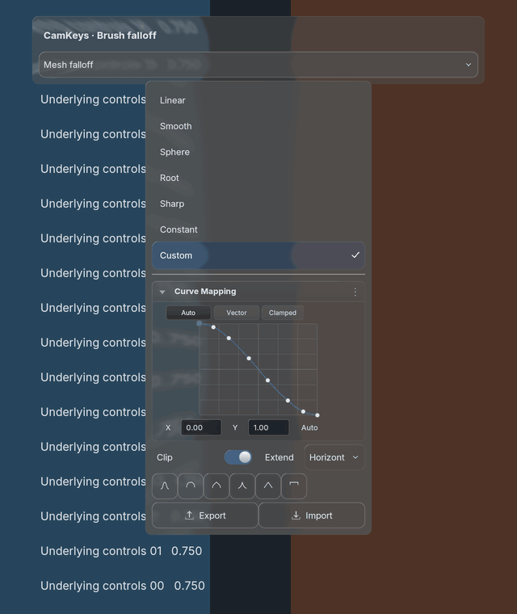 |

[Full review and capture provenance](docs/design/qa/core-review-v2/index.html) ·
[Historical feature recordings](docs/FEATURE_GALLERY.md)

## What you get

- Layouts, labels/icons, buttons, switches, sliders and editable text/numbers.
- Searchable enums, data selectors, lists, menus, popovers and pie menus.
- Color pickers, ramps, curves and other specialized controls with explicit limits.
- Owner-aware right-click actions, keyboard interaction, shortcuts and nested menus.
- Shared liquid glass, active Blender theme colors and configurable source motion.
- Independent extension-local imports, bundled assets and a recorded vendor manifest.

## Compatibility and scope

**Embedded panels are currently execution-tested on macOS arm64 Blender 5.1.2
and 5.2.2 and require admitted exact-build native adapters.** Unsupported hosts
show an explicit availability reason. Copying the package does not qualify every
Blender build, Windows or Linux. [Runtime details](docs/VALIDATION.md).

The toolkit targets third-party N-panels, Properties panels and their reusable
controls—not Blender's built-in modifier stacks or editor interfaces. Full
right-click and visual parity still have [documented gaps](docs/CORE_CONTEXT_AUDIT.md).
Current styling is ready for use/review; exact generated-reference matching and
all platform/state combinations are not certified.

## Advanced integration and development

`AddonUI` is optional. Use `Layout`, `Canvas`, `PanelHost`, bindings and
`ShortcutRegistry` independently when integrating an existing renderer/modal.
Importing the library performs no registration, compilation, timers or scene edits.

[Integration](docs/INTEGRATION.md) · [Animation](docs/ANIMATION.md) ·
[Theming](docs/THEMING.md) · [Context menus](docs/CONTEXT_MENUS.md) ·
[API inventory](docs/api_inventory.json) · [Parity ledger](docs/CUSTOM_PARITY.json)

```sh
uv run python -m unittest discover -s tests -p 'test_*.py'
uv run ruff check beyond_ui tests tools
```

## License

GPL-3.0-or-later. Preserve the bundled [license](LICENSE),
[notice](beyond_ui/NOTICE) and font licenses when vendoring.
Derived from Beyond VTuber Tools' Effect Layers UI; see [provenance](docs/PROVENANCE.md).
