# Historical feature gallery

These are earlier implementation recordings. Use the [current review](design/qa/core-review-v2/index.html) for current core styling.

## Panel overview

[All recorded feature GIFs and current remaining-work estimate](design/qa/overview/index.html)


Actual Blender-rendered panels with the shared squash-and-stretch animations.
The older previews below are a historical feature archive. For current styling, use
the refreshed core review above; full visual parity remains in progress. [Animation settings](ANIMATION.md) control strength and
whether motion is enabled.

| Curve Mapping | Color Ramp |
| --- | --- |
| 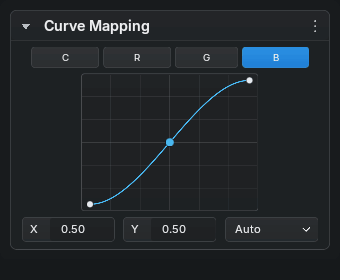 | 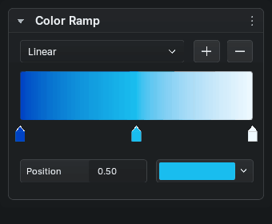 |
| **Data Picker** | **Color Picker** |
| 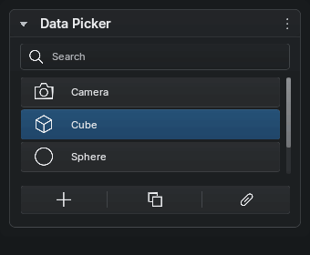 | 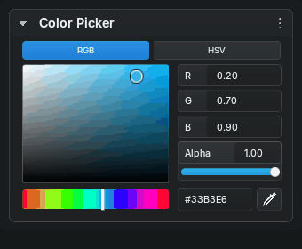 |
| **Palette** | **Matrix decomposition** |
| 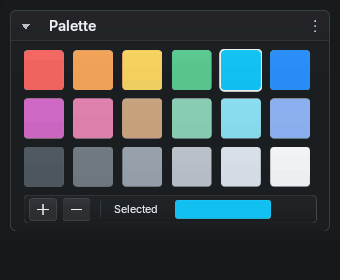 | 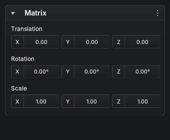 |
| **Progress Bar** | **Progress Ring** |
| 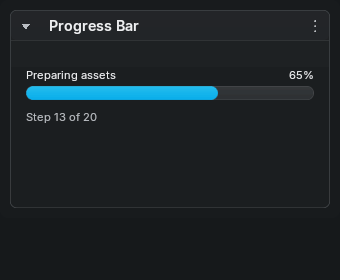 | 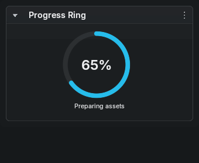 |

[Full motion overview](design/qa/next-v1/motion.gif) ·
[Generated references versus implementations](design/qa/next-v1/all-controls-comparison.png)

Previews explicitly use the fixed artwork palette and translucent tint fallback
over a neutral backdrop. Production defaults to Blender’s active theme across
all eight panels; see [theme configuration and QA](THEMING.md). A consuming
host can provide the shared blurred viewport backdrop. [Capture provenance](media/panels/provenance.json).

## Hold actions and component popups

Hold buttons open searchable custom menus after 0.2 seconds; quick release runs
only the primary action. Owned popups support confirmation/cancellation, and
component popups retain editing with searchable long enum lists. Ordinary fields
now consume alert and emboss/status styles through Blender's active theme.
[Behavior and limits](ACTION_PARITY.md) ·
[Runtime QA at three UI scales](design/qa/action-parity-v1/index.html)

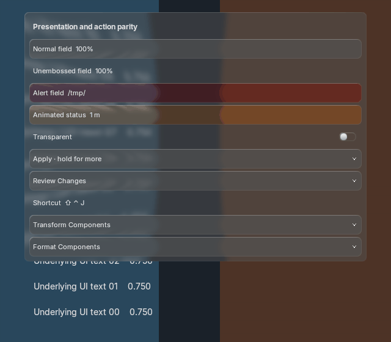

## Popup keyboard actions

Popovers can open with a selected text/numeric field and a default Return action.
Edits commit before execution; nested menus and stale owners retain their guards.
[Keyboard QA](design/qa/popup-focus-v1/index.html) ·
[Behavior and remaining gaps](POPUP_KEYBOARD.md)

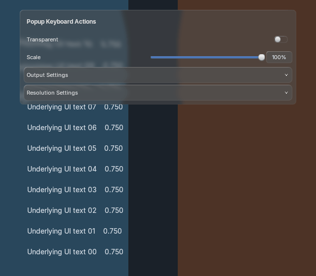

Registered marking menus now share the existing liquid glass, theme and spring
painter. Mouse selections dispatch on release, with exact-owner revalidation.
Eight directions now support nested row/column/box slots and exact child contexts.
Preference-based tap/hold/recenter timing, pointer-origin growth, elastic surface
pull, proximity highlighting and an origin guide now have actual GPU captures.
Circular placement avoids overlapping slots; property labels retain their own
space beside switches and fields. Visual acceptance and full parity remain open.

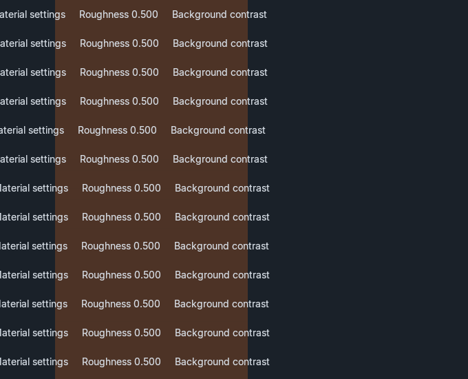


[Current pie gallery, scale checks and focus audit](design/qa/marking-menu-v3/index.html) ·
[Earlier execution report](design/qa/marking-menu-v2/index.html) ·
[Integration and limits](MARKING_MENUS.md)


Nested pie menus now support mouse/keyboard Back, exact child contexts and
list-to-pie navigation. Compound slots add split/grid/column flow, alignment,
logical sizing, scale and spacers through the shared retained layout engine.

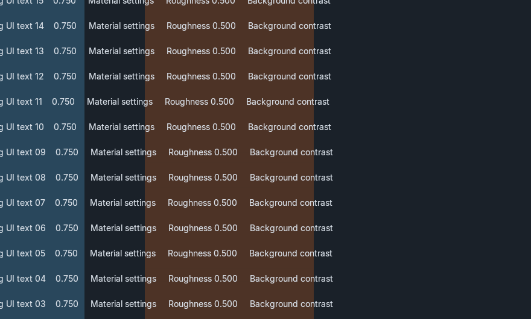

[Nested pie QA and PNG frame scrubber](design/qa/marking-menu-v4/index.html) ·
[Integration and remaining gaps](MARKING_MENUS.md)


Standalone `Layout.menu_pie()` now opens without a registered menu class. Pie
items stretch only while approaching; entering the logical petal restores their
resting shape. Compound slots add alert/status styling, unembossed fields, split
labels, optional decorators and initial field/default selection.

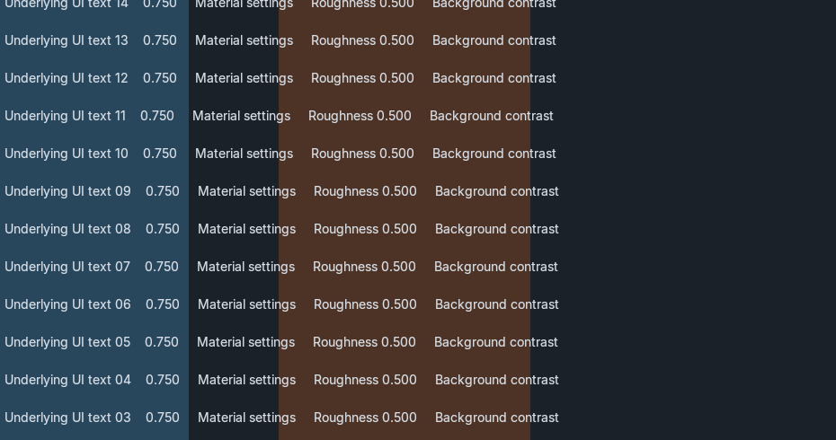

[Approach versus hover, compound flags and frame scrubber](design/qa/marking-menu-v5/index.html) ·
[Standalone integration and explicit parity limits](MARKING_MENUS.md)

## Layout sizing

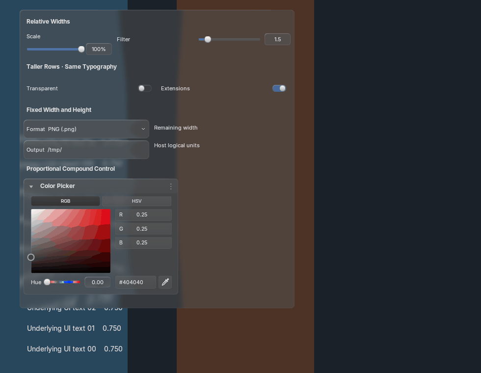

[Layout sizing QA](design/qa/layout-sizing-v1/index.html) ·
[Scale and fixed-unit behavior](LAYOUT_SIZING.md). Explicit sizing retains
source typography, proportional compound controls and exact-owner menus.

## Collection lists

Default collection lists now support original-index selection, rename, filtering,
sorting, virtual scrolling, compact/grid layouts and exact row context menus.
PropertyGroup collections require host-owned stable identity keys.

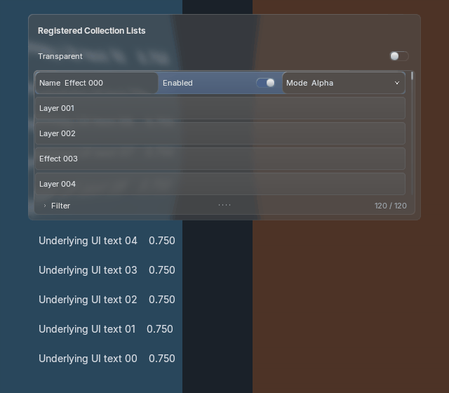

[Registered list QA](design/qa/registered-lists-v1/index.html) ·
[Callback support and remaining gaps](REGISTERED_LISTS.md). Python row/filter
callbacks use retained custom fields, owner menus and source motion. Full parity
and reference acceptance remain open.

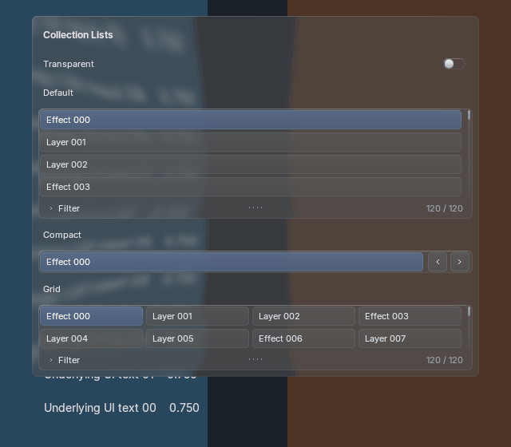

[Collection list QA](design/qa/collection-lists-v1/index.html) ·
[Supported cases and remaining list gaps](COLLECTION_LISTS.md)

## Panel popovers

Registered panels open as custom canvases with nested controls, scrolling,
property-attached panels and exact-owner context menus.

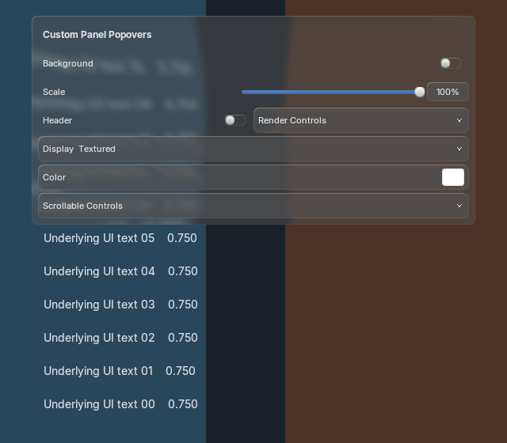

[Panel popover QA](design/qa/panel-popovers-v1/index.html) ·
[Authoring and remaining gaps](POPOVERS.md)

## Registered menus

Registered Python menus render through custom searchable dropdowns, inline
contents and property-attached menus, with exact-row right-click actions.

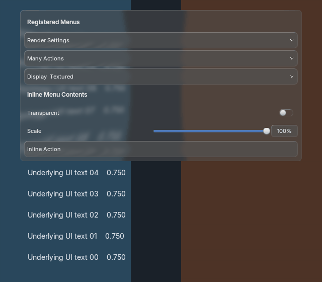

[Registered menu QA](design/qa/registered-menus-v1/index.html) ·
[Authoring and remaining gaps](REGISTERED_MENUS.md)

## Data-block selectors and tabs

Searchable ID selectors, editable names, user counts, Fake User switches and
New/Open/Unlink actions reuse the shared BVT controls. Pending edits and menus
stay tied to their original selection.

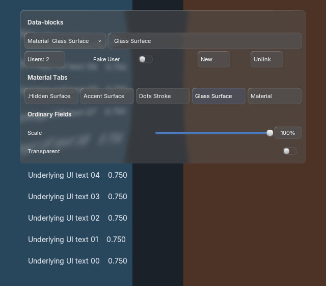

[ID template QA](design/qa/id-templates-v1/index.html) ·
[Integration and remaining gaps](ID_TEMPLATES.md)

## Split layouts and responsive grids

Split columns, automatic grids and height-balanced flows retain the shared BVT
controls. Parent enable/active state and horizontal flexible spacing work across
the layout tree.

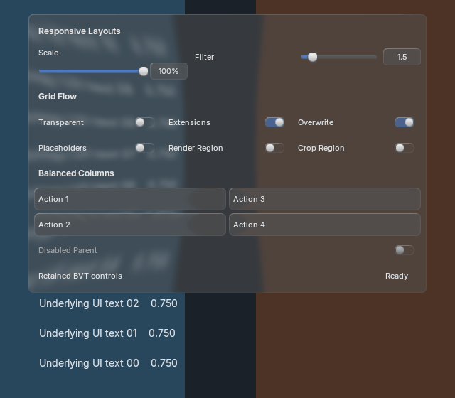

[Layout QA](design/qa/layout-flow-v1/index.html) ·
[Layout behavior and remaining gaps](LAYOUT_FLOW.md)

## Operator choices

Expanded operator actions and searchable operator dropdowns now use the shared
BVT controls, with exact argument snapshots and checks before execution.

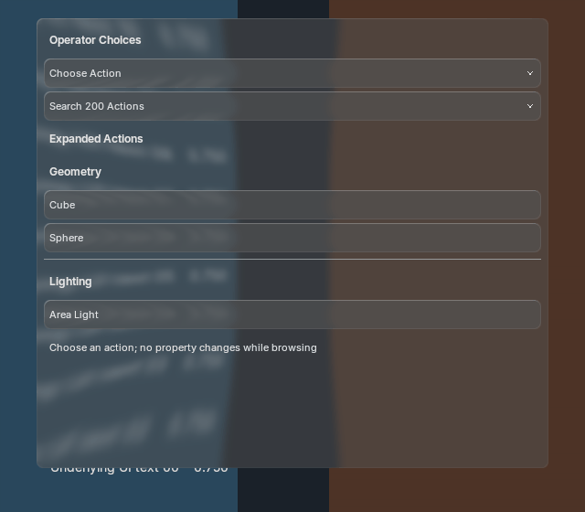

[Operator choice QA](design/qa/operator-enums-v1/index.html) ·
[Integration and remaining gaps](OPERATOR_CHOICES.md)

## Sliders and switches

Sliders use BVT’s label, thin rail, animated bubble handle and separate number
entry. Boolean properties use glass toggle switches, including menu rows.
Hue and alpha use the same slider layout; narrow rows stack their labels.

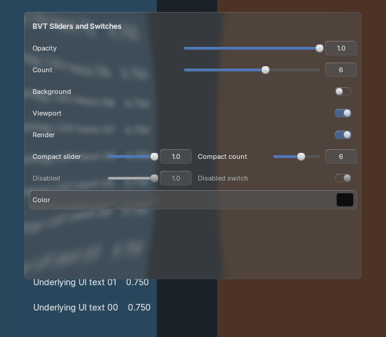

[Your screenshots versus implementation](design/qa/scalar-layout-v1/index.html) ·
[Behavior and integration](SCALAR_CONTROLS.md)

## Context menus

Shared right-click menus now support owner-aware property actions, nested Back
navigation, keyboard shortcuts, cancellation and delayed descriptions. Menus
and tooltips use BVT’s liquid-glass blur/refraction by default in the embedded
host, with one retained backdrop shared across controls and animation frames.

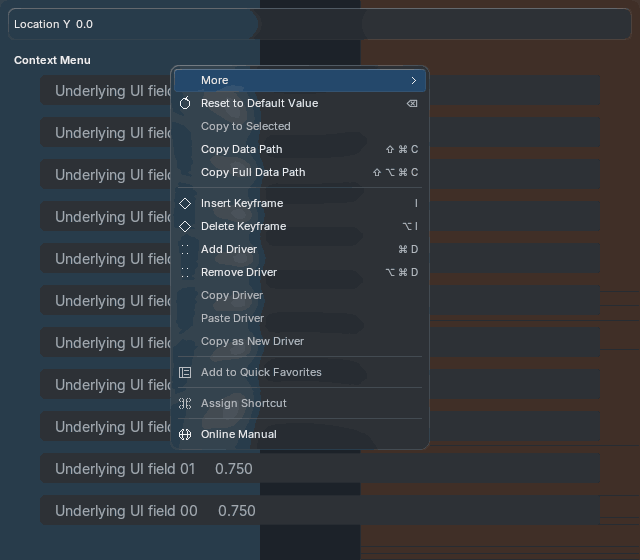

[Glass versus tint and all eight control targets](design/qa/context-menu-v1/index.html) ·
[Context menu integration](CONTEXT_MENUS.md) ·
[Menu capture provenance](media/panels/context-menu-provenance.json)

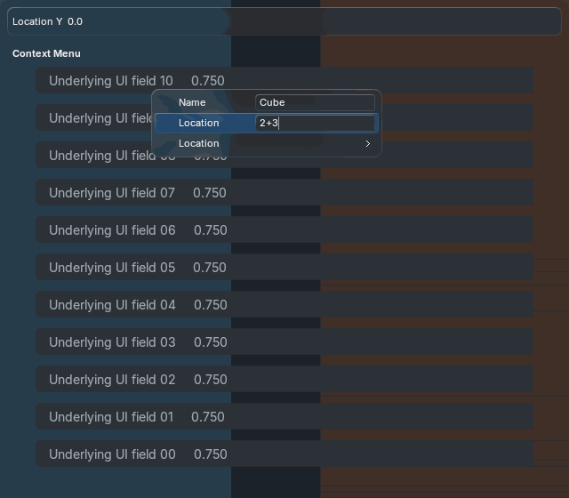

[Current menu adapters and glass captures](design/qa/context-menu-v5/index.html)
cover real driver clipboard copy/paste, Quick Favorites add/remove, enum-value
and flag shortcuts, custom-popup dispatch, keyboard/mouse/key-modifier capture, contributed scalar/array/boolean/enum
choices, Edit Source and Python tooltips. Capture modes support keyboard selection;
inline menu contributions preserve disabled state and invocation, and operator
arguments use bounded snapshots with stale-owner checks. These adapters are
execution-tested on macOS arm64 Blender 5.1.2 and 5.2.2; private APIs require exact
source/executable admission. See the [supported cases and gaps](CONTEXT_MENUS.md).
Exact generated-reference/motion acceptance is still open. The earlier panel GIFs above are tint-fallback fixtures; this menu
preview exercises the real liquid-glass path.

Every right-click option now follows the opening bounce, including labels,
shortcut hints and disabled rows. Native deferred-text batching is covered by
pixel comparisons on both tested Blender versions.

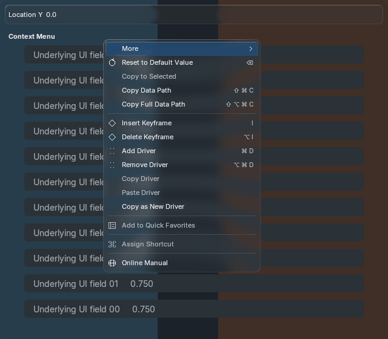

[Before/after menu motion QA](design/qa/context-menu-v6/index.html)

Numeric properties now support scene units, angles, percentage factors and source-style
dragging through the same glass/theme/motion path.

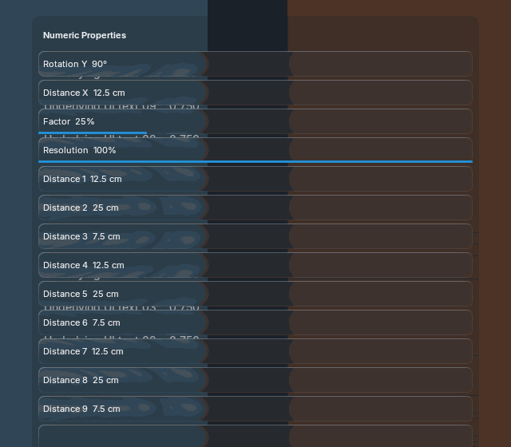

[Numeric property QA](design/qa/numeric-props-v2/index.html) ·
[Supported semantics and remaining gaps](NUMERIC_PROPERTIES.md)


Wide numeric fields now use **15% bounce amplitude**, with the same spring timing.
The QA page includes an original/current motion comparison.

Event properties now use the shared custom glass capture menu for keyboard, mouse
and held-key chords, with owner validation and host-owned commit/rollback.

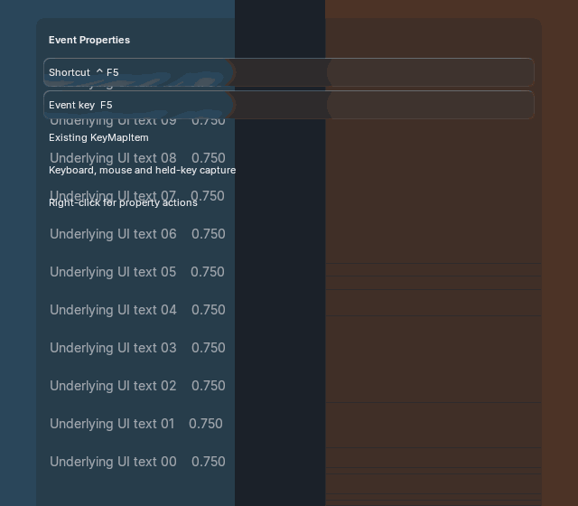

[Event property QA](design/qa/event-props-v1/index.html) ·
[Supported semantics and open gaps](EVENT_PROPERTIES.md)

Pointer properties now open a custom searchable ID picker, with owner-checked
selection and candidate right-click menus. Compact animation decorators show
keyed, changed, animated and driven states beside supported properties.

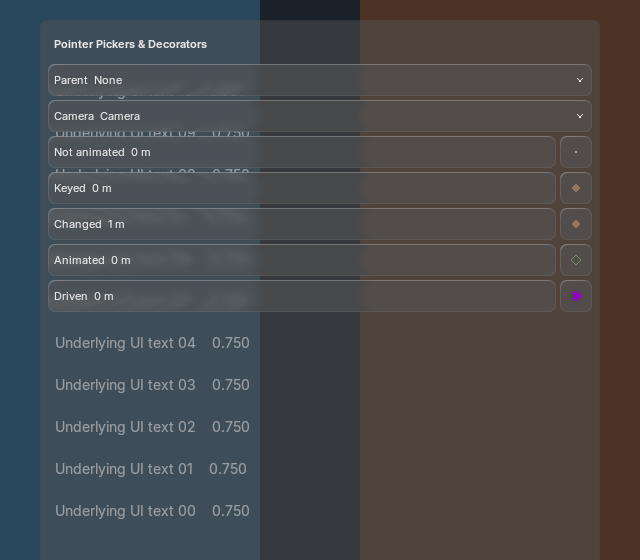

[Pointer/decorator QA](design/qa/pointer-decorators-v1/index.html) ·
[Policies, host undo and remaining gaps](POINTERS_AND_DECORATORS.md)

Collection searches now validate stale rows and host commits, support custom
result labels and optional free-text suggestions, and animate row contents together.
Standalone vector decorators expand into exact component controls.

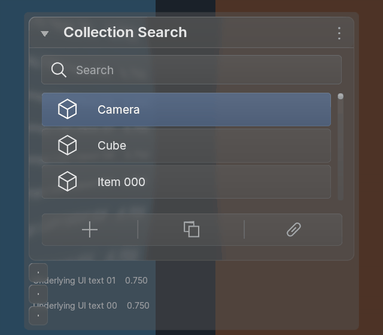

[Search QA and before/after row motion](design/qa/collection-search-v1/index.html) ·
[Search integration and remaining gaps](SEARCH_PROPERTIES.md)

Search properties now default to compact fields with on-demand glass popovers.
Type immediately after opening; full-card mode remains an explicit backend option.

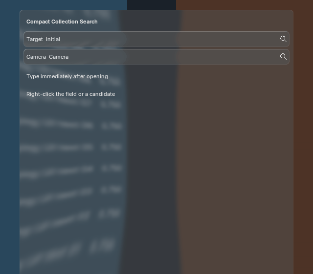

[Compact search QA](design/qa/search-popover-v1/index.html) ·
[Search integration](SEARCH_PROPERTIES.md)

Named non-ID pointers now support active bones/nodes and collection-owned search
properties, with host revision checks and shared glass/motion/context menus.

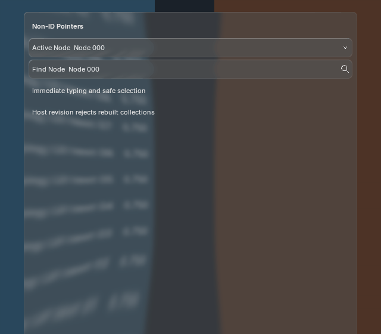

[Non-ID pointer QA](design/qa/non-id-pointers-v1/index.html) ·
[Host policy and revision setup](POINTERS_AND_DECORATORS.md#non-id-pointers-and-collection-owned-properties)

The current scale audit supersedes the oversized presentation in earlier galleries:
all compound controls now use the surrounding panel's logical UI scale.


[All-control scale audit and before/after](design/qa/ui-scale-v1/index.html) ·
[Logical sizing contract](UI_SCALING.md)

The enum-property pass unifies mouse/shortcut menus, long lists, flag choices and
transactional expanded buttons while retaining the shared styling and scale:

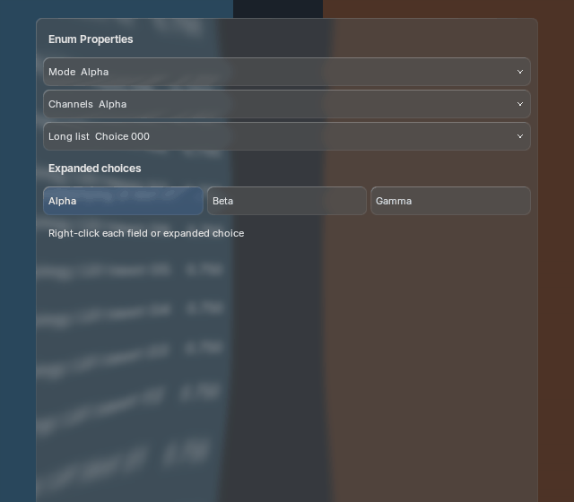

[Enum QA gallery](design/qa/enum-properties-v1/index.html) ·
[Enum integration and remaining gaps](ENUM_PROPERTIES.md)

The next enum pass adds grouped menus, headings/separators, Shift-aware flag strips
and enum metadata helpers:

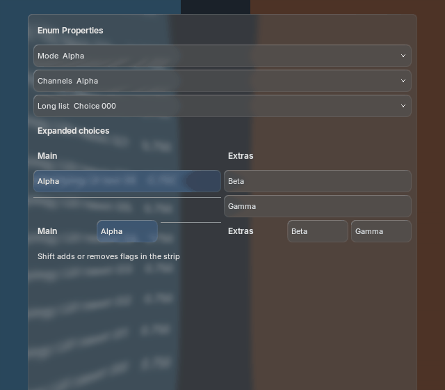

[Enum groups QA gallery](design/qa/enum-properties-v2/index.html)

Long enum and action dropdowns now search as you type, retaining their original
owners, glass and motion. Small menus keep their existing layout.


[Searchable dropdown QA](design/qa/menu-search-v1/index.html) · [Configuration](MENU_SEARCH.md)

## Requirements

Every control must have custom appearance **and** custom interactions. Generated
references are exact visual specifications, not loose inspiration. Geometry,
spacing, typography, icons, colors, glass treatment and depicted states must
match. An actual Blender capture and direct reference comparison are required
before visual acceptance. These are hard rules in [AGENTS.md](../AGENTS.md).

## Vendor into an extension

Copy the `beyond_ui/` package, including `LICENSE`, `NOTICE` and optional native
artifacts, into your extension's `vendor/` folder. Import it relatively; no pip
install or global Python path modification is required.

```python
from .vendor.beyond_ui import Layout

# Custom authoring: use the returned canvas with your host adapter.
ui = Layout(context=context, commit=on_committed_edit)
ui.label(text="Settings")
ui.prop(settings, "enabled")
ui.prop(settings, "strength", slider=True)
ui.template_color_picker(settings, "color")
canvas = ui.canvas
```

Your extension owns settings, operators, registration, undo and translations.
Unsupported custom methods raise `UnsupportedControl`; there is no silent
native-widget fallback. The [ledger](CUSTOM_PARITY.json) includes limitations
of partially implemented methods; `supports()` is not a visual acceptance claim.

For an owned N-panel or Properties panel, use
`beyond_ui.hosts.panel.PanelHost`. It anchors custom GPU controls inside the native
layout. The experimental bundled adapter is restricted to exact macOS arm64
Blender builds. Other platforms can use pure components or an explicitly chosen
native compatibility UI while a custom host adapter is qualified.

See [examples/demo.py](../examples/demo.py) for registration, stable input activation,
per-region canvases, event routing, invalidation and teardown.

## Components

* `Canvas`, `Layout`, `Binding`, `Edit`: retained controls and host-owned edits.
* `widgets`: custom color picker, curve/ramp editor, searchable data picker,
  virtualized palette, read-only matrix decomposition and progress bar/ring.
* `AnimationSettings`: shared source springs with live enable/strength policy;
  see [animation integration and remaining gaps](ANIMATION.md).
* `components`, `virtual`, `editing`: Blender-independent layout/search/clipping,
  indexed virtualization, text selection, safe number parsing and color math.
* `gpu`: extracted rounded primitives, semantic vector icons, finite springs,
  theme roles, shared glass and bounded texture/material previews.
* `hosts`: exact-build native N-panel anchor and independent owner lifecycle.

Imports do not register RNA, install timers, mutate scenes/preferences, download
code or invoke compilers. Relative imports isolate vendored copies. Optional
native callbacks are multiplexed so extensions cannot replace each other's
callback ownership.

## Optional native compatibility

`NativeLayout(self.layout)` forwards the full installed Blender UI API unchanged,
including specialized templates. It retains native behavior and is useful as a
compatibility path or test reference. It **does not satisfy custom parity**.
Native Panel/Menu/Header/UIList classes remain host-owned.

The exact-version [API inventory](api_inventory.json) covers Blender
4.2–5.2 and includes all documented members, not just selected examples.
[The routing table](COVERAGE.md) documents the native reference surface;
[the custom ledger](CUSTOM_PARITY.json) is the custom implementation authority.

## Development

```sh
uv sync
uv run python -m unittest discover -s tests
uv run ruff check beyond_ui tests tools examples
uv run python tools/check_custom_parity.py
python3 tools/run_blender_tests.py --blender /path/to/blender
python3 tools/run_blender_tests.py --blender /path/to/blender --windowed
```

Tests preserve your foreground app: headless by default; windowed GPU captures
and panel input use Blender's `--no-window-focus`, with no foreground fallback.
See [background testing and the focus audit](BACKGROUND_TESTING.md).

`tools/check_custom_parity.py --require-complete` is the strict release gate.
It currently fails because full custom parity and exact reference matches are
unfinished. Ordinary CI verifies the ledger's completeness and current code;
passing CI must not be described as full UI parity.

Runtime runners use disposable profiles, timeouts and mandatory result records.
They never save the user's current Blender file or preferences. The optional
macOS bridge is built explicitly with `python3 tools/build_bridge.py`.

[Architecture](ARCHITECTURE.md) · [Provenance](PROVENANCE.md)

GPL-3.0-or-later. Preserve the license and notice when vendoring.

### Current menu spacing and macOS-style controls

[Review approved reference beside the current Blender implementation](design/qa/menu-spacing-v1/index.html). Shared spacing, search magnifiers, unboxed options, bold titles, dark fields and larger switches. Exact reference acceptance remains open.

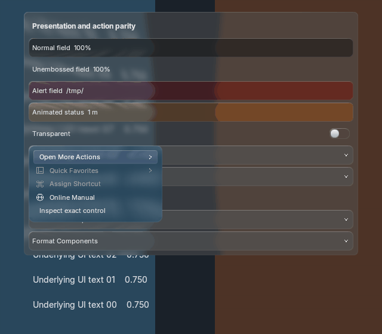

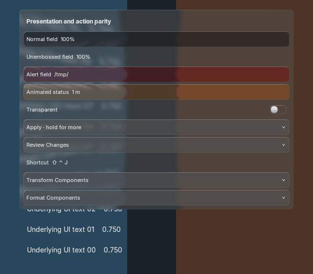

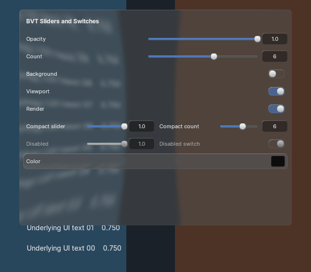

### External field labels and optional icons

[Current macOS-style field/menu review](design/qa/menu-spacing-v2/index.html) · [Label and icon API](FIELD_LABELS.md). Labels sit outside editable values; optional icons share theme colors and motion. Confirmation actions center their labels. Search/inset fields use a fine outline, and menu highlights expand without moving rows. Exact reference acceptance remains open.

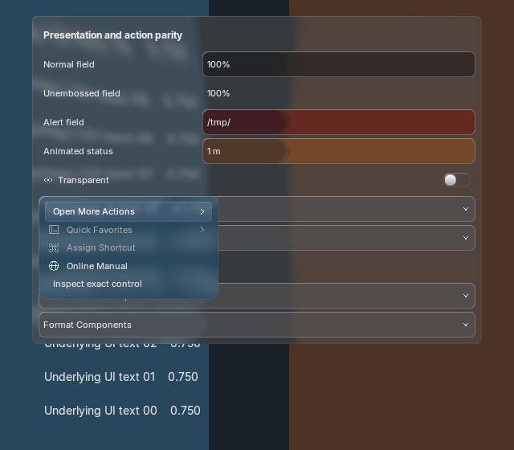

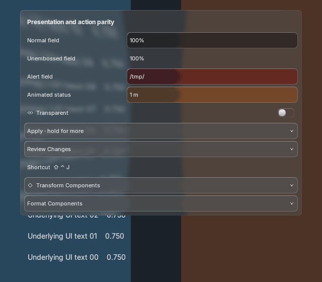

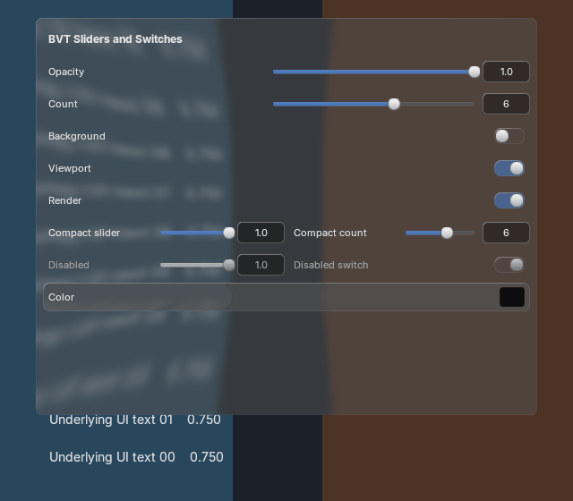


## CamKeys Studio preset previews

Real Blender GPU captures of the shared change pulse. Appearance uses state snapshots. Generated references and conditional-state limits are on the Studio review page.

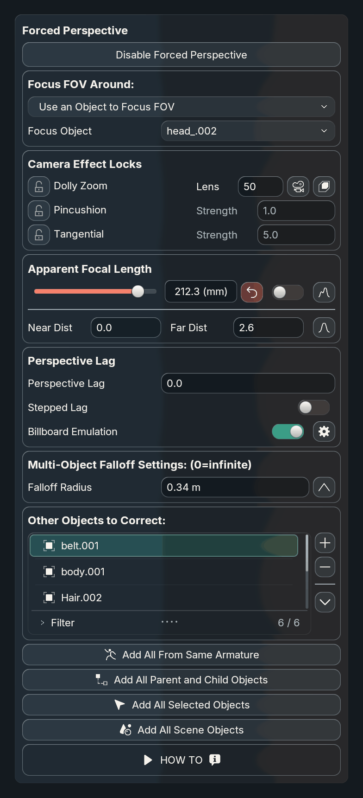

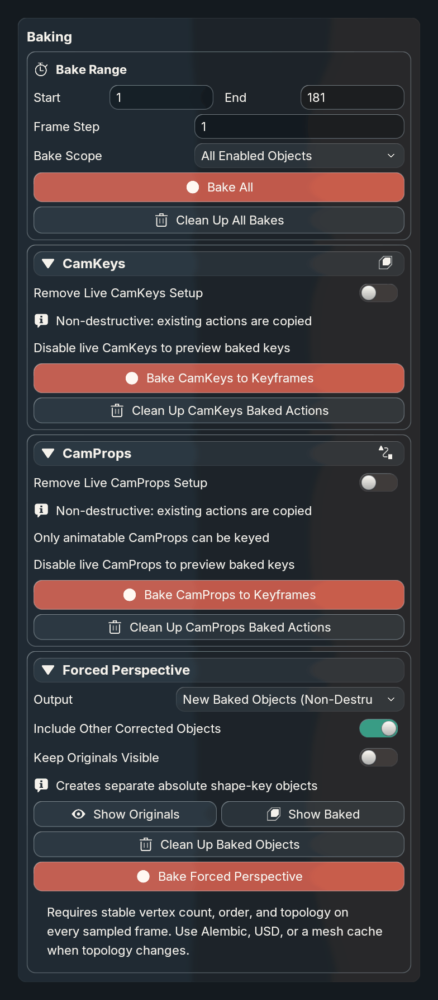

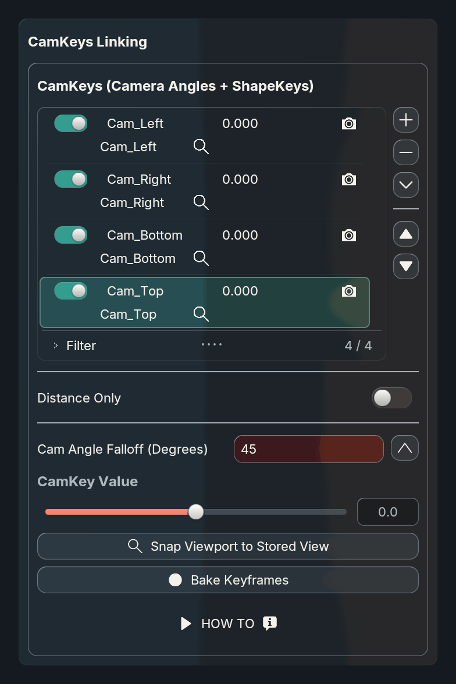

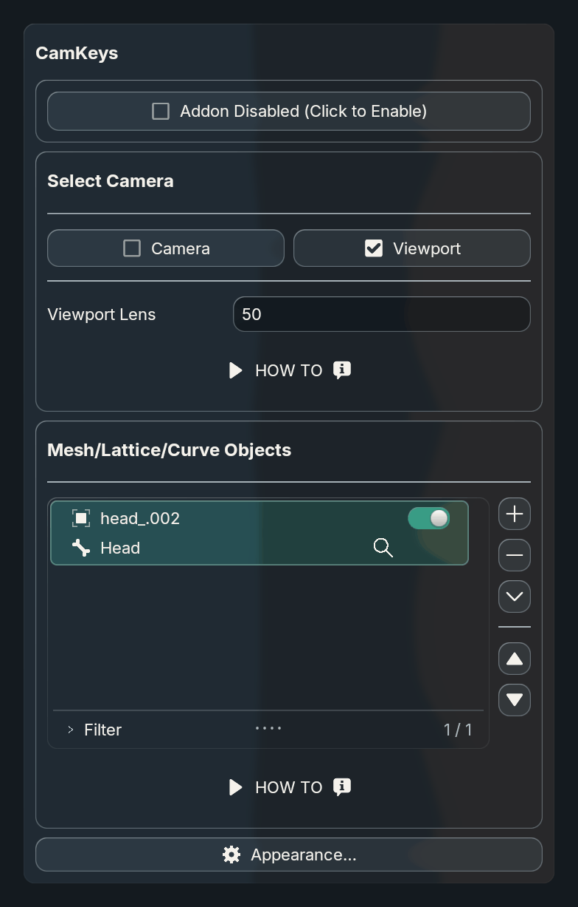

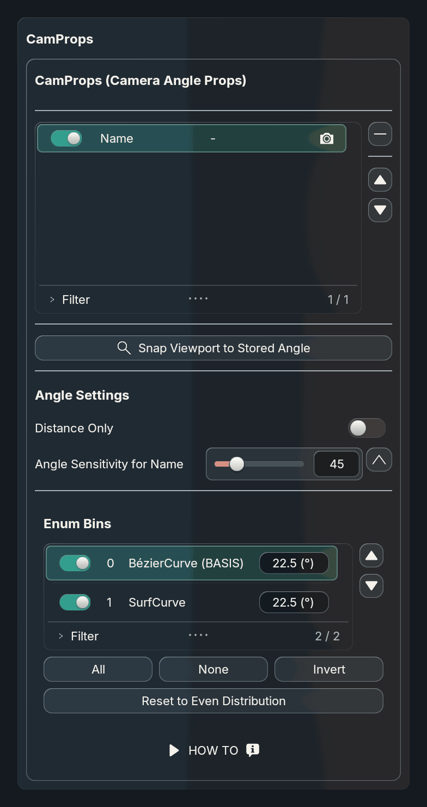

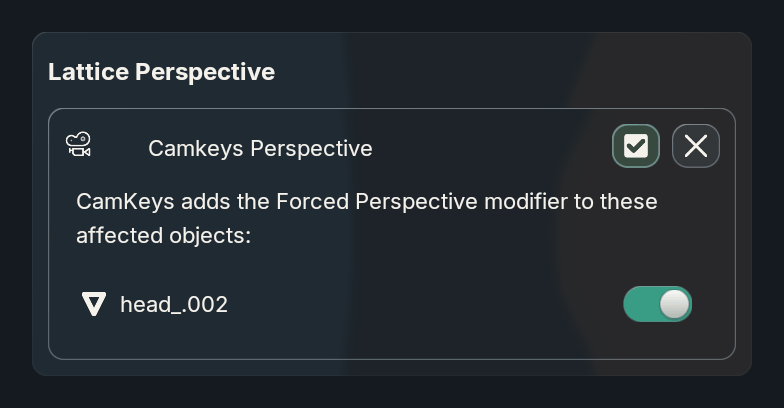

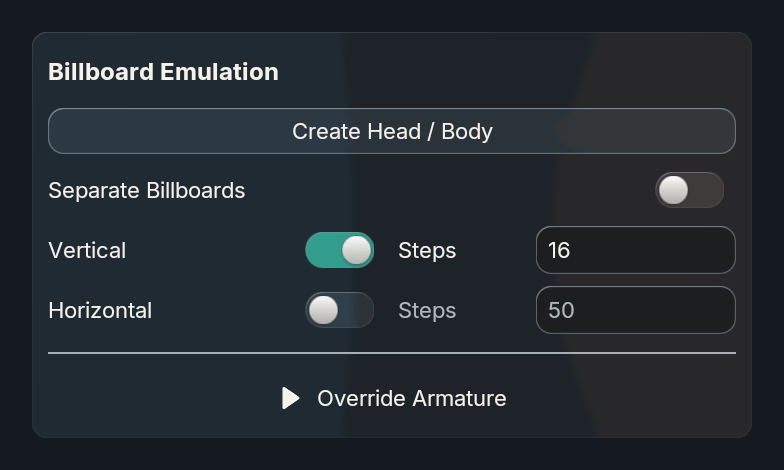

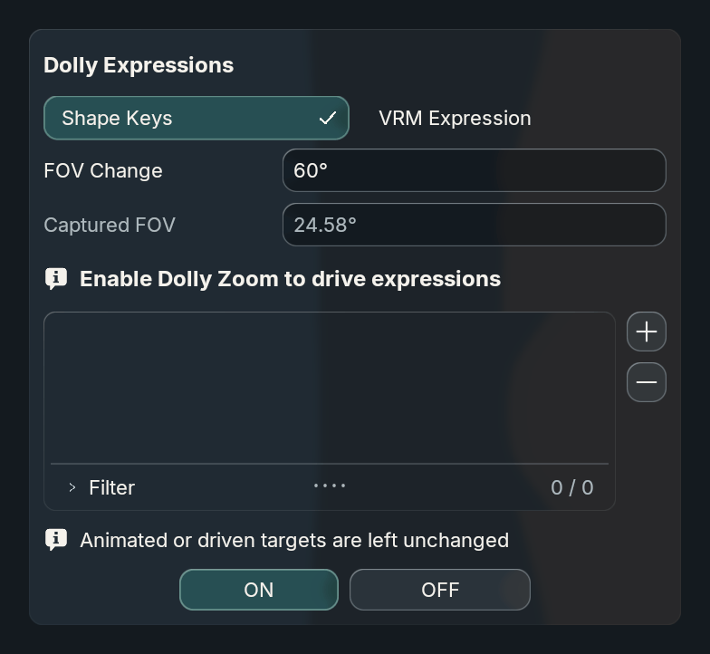

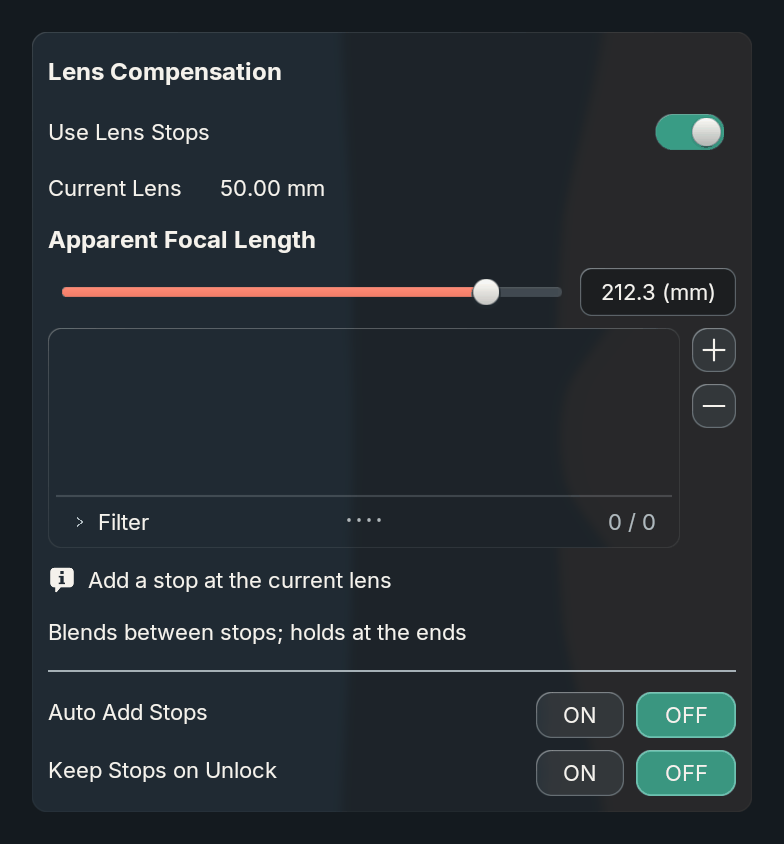

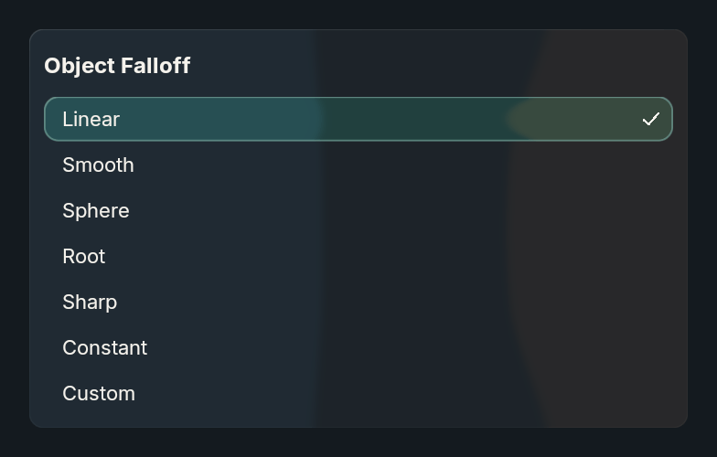

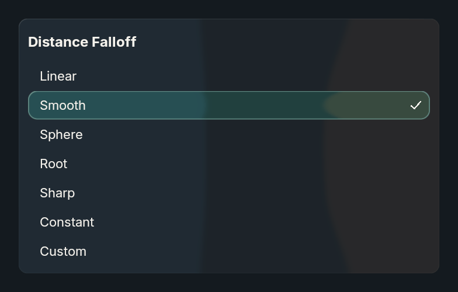


